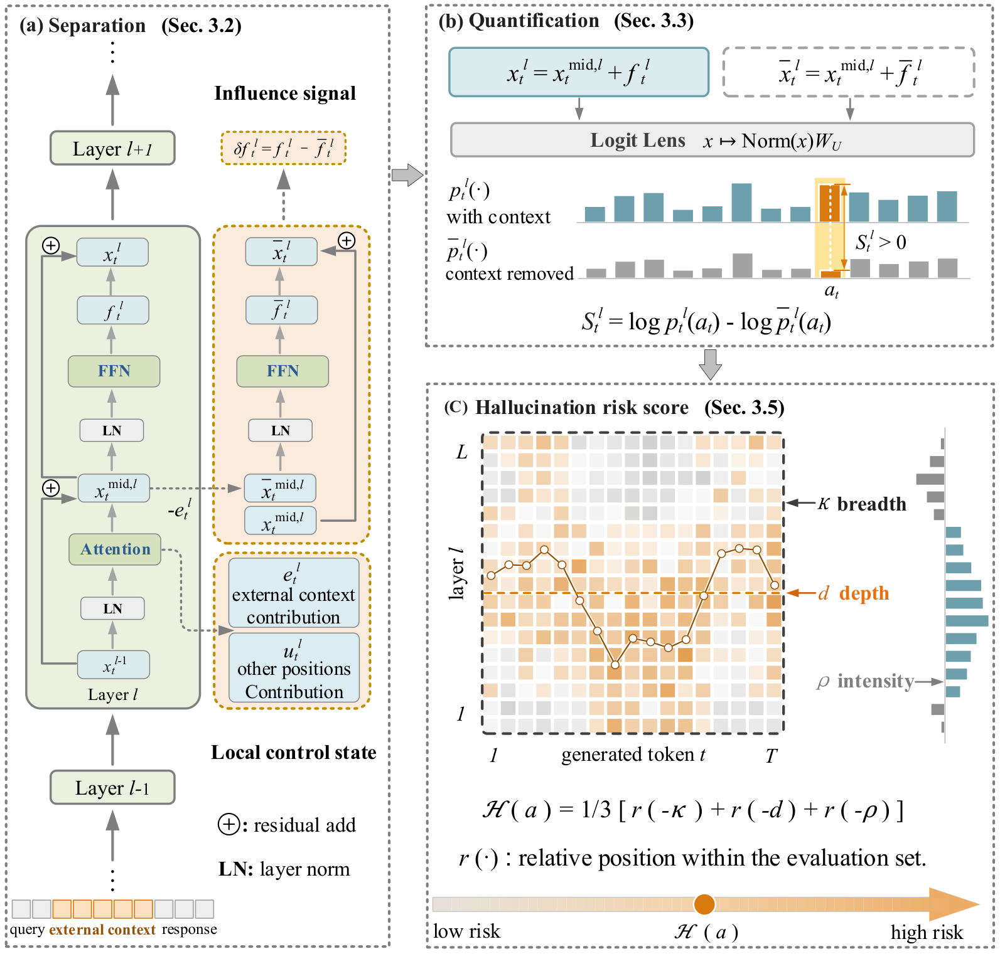

# CASDET

[](https://doi.org/10.5281/zenodo.23468986)

**CASDET: Detecting RAG Hallucinations Considering Attention--FFN Cascade Influence**

Qiyang Gu, Pengyu Guo, Fei Zhang

This repository contains the official implementation and experiment code for
CASDET.

## Overview

CASDET is a training-free method for detecting hallucinations in
retrieval-augmented generation (RAG). For each Transformer block, it constructs
a local control state by removing only the current layer's external-context
contribution at the FFN input, separates the influence signal as the difference
between the two FFN outputs, and quantifies it with the Logit Lens as the
change in the current token's predicted probability. The layer-wise results are
summarized into **influence breadth**, **influence depth**, and **influence
intensity**, which are combined into a response-level hallucination risk score.
The method requires no thresholds and no selection of specific attention heads
or Transformer layers.



The paper reports main results on RAGTruth and HalluRAG with Llama2-7B,
Llama2-13B, Llama3-8B, and Mistral-7B, a graded local-intervention validation
(Page's L test), and ablation studies.

## Repository structure

```
.
├── main.py                  # Unified entry point
├── CASDET/                  # Core package
│   ├── casdet.py            # Influence signal, statistics, risk score
│   ├── model_adapter.py     # Model loading and Attention/FFN state capture
│   ├── datasets.py          # RAGTruth / HalluRAG loading and alignment
│   ├── metrics.py           # AUROC, AUPRC, PCC, Page's L test
│   ├── experiments.py       # Main, intervention and ablation pipelines
│   ├── figures_weight.py    # Figure 5 (weight simplex)
│   └── utils.py             # Configuration, logging, saving, plotting
├── scripts/
│   ├── prepare_ragtruth.py  # Raw RAGTruth corpus -> per-model JSONL
│   ├── prepare_hallurag.py  # HalluRAG pickles -> per-model JSON
│   ├── make_figures.py      # Regenerate Figures 2-5
│   └── check_env.py         # Check GPU, dependencies and input paths
├── log/
│   ├── configs/             # Experiment configurations
│   └── results/             # Reference result JSON and intervention NPZ
├── dataset/                 # Data root (not included; see dataset/readme.md)
├── models/                  # Local model weights (not included)
├── figs/                    # Figures used in the paper
├── tests/                   # Unit tests
└── requirements.txt
```

## Installation

The reported experiments were run on a server with two AMD EPYC 9334
processors, 256 GB of memory, and three NVIDIA GeForce RTX 4090 GPUs (24 GB
each), under Windows 10 (build 19045). The software environment is Python
3.12.0, PyTorch 2.3.1 with CUDA 12.1, and transformers 4.57.6.

Install the matching PyTorch build first, then the remaining dependencies:

```bash
pip install torch==2.3.1 --index-url https://download.pytorch.org/whl/cu121
pip install -r requirements.txt
```

`accelerate` is required for the `device: auto_multi` device-map split used by
Llama2-13B. Select visible GPUs with `CUDA_VISIBLE_DEVICES`; the code does not
hard-code a device. Llama2-13B in fp16 needs more than one 24 GB GPU.

Run all commands from the repository root. Check the environment and input
paths before the first run:

```bash
python scripts/check_env.py
```

## Model preparation

Download the base models from Hugging Face and place them under `models/`:

```bash
huggingface-cli download meta-llama/Llama-2-7b-chat-hf \
    --local-dir models/Llama-2-7b-chat-hf
huggingface-cli download meta-llama/Llama-2-13b-chat-hf \
    --local-dir models/Llama-2-13b-chat-hf
huggingface-cli download meta-llama/Meta-Llama-3-8B-Instruct \
    --local-dir models/Llama-3-8B-Instruct
huggingface-cli download mistralai/Mistral-7B-Instruct-v0.1 \
    --local-dir models/Mistral-7B-Instruct-v0.1
```

The Llama models are gated; request access on Hugging Face first. Paths can be
changed in `log/configs/*.yaml`.

## Data preparation

See [`dataset/readme.md`](dataset/readme.md) for the download links, the
expected layout, the preparation commands, and the checksums. The datasets are
not redistributed with this repository.

```bash
python scripts/prepare_ragtruth.py \
    --raw-dir dataset/ragtruth/redeep_raw --out-dir dataset/ragtruth
python scripts/prepare_hallurag.py \
    --data-dir dataset/hallurag --quant-13b int8
```

## Running

```bash
# Main experiments (Table 1)
python main.py --task main

# Graded local intervention and Page's L test (Table 2, Figure 2)
python main.py --task intervention

# Ablation studies (Figure 3)
python main.py --task ablation

# Run all three tasks in order
python main.py --task all

# Quick server smoke test (one model, 100 samples)
python main.py --task main --config log/configs/smoke.yaml
```

Generate the paper figures from the saved results:

```bash
python scripts/make_figures.py                # writes fig2-fig5 PDFs
python scripts/make_figures.py --out-dir out  # custom output directory
```

Figure 1 is hand-drawn and is not generated by the code. Figures 2-5 are
regenerated from `log/results` with the paper styling; the included reference
results make this possible without a GPU.

The manuscript figures use Arial. If Arial/Helvetica is not installed on the
server, Matplotlib falls back to DejaVu Sans and the typography will differ
slightly; install Microsoft core fonts (or Arial/Helvetica) if identical
figure output is required. `scripts/make_figures.py` reports which font is
available.

Useful options:

```bash
python main.py --task main --model llama2_7b   # one model only
python main.py --task main --debug             # verbose logging
python main.py --task main --config my.yaml    # custom configuration
```

Results are written to `log/results/<task>/`. Reference results from the paper
are included there as JSON (and the intervention effects as NPZ), so the
numbers and Figures 2-5 can be reproduced without a GPU. The manuscript
figures are provided in `figs/`; `scripts/make_figures.py` writes freshly
generated vector PDFs to `figs_generated/`. Running an experiment overwrites
the corresponding result files; copy the directory first if you want to keep
the reference copy.

## Notes on the score

The response-level score is **defined on an evaluation batch**. Two ingredients
depend on the batch: the layer scale `sigma_l` (standard deviation of the
per-layer effects within the evaluated set) and the relative positions used to
combine breadth, depth, and intensity (Eq. 16). Consequently, the repository
provides a batch-scoring/experiment interface rather than a single-response
`predict()` function that would hide this dependence.

## Citation

```bibtex
@article{gu2026casdet,
  title   = {CASDET: Detecting RAG Hallucinations Considering
             Attention--FFN Cascade Influence},
  author  = {Gu, Qiyang and Guo, Pengyu and Zhang, Fei},
  journal = {Discover Computing},
  year    = {2026}
}
```

## License

The code is released under the MIT License. See [`LICENSE`](LICENSE). The
license does not cover the datasets or the model weights; see
[`dataset/readme.md`](dataset/readme.md) and the corresponding model licenses.

## Contact

Qiyang Gu, `guqyams@163.com`
